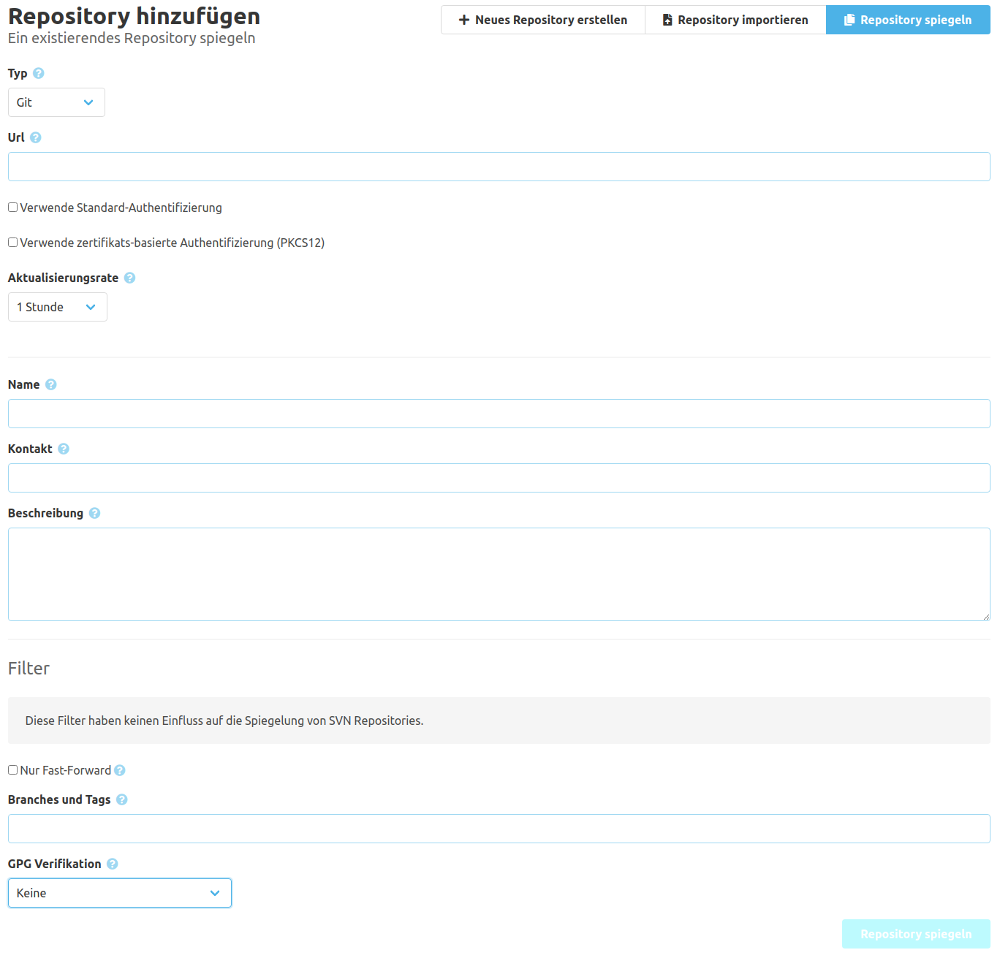
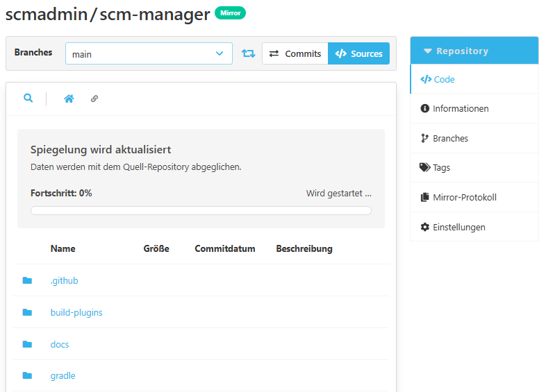
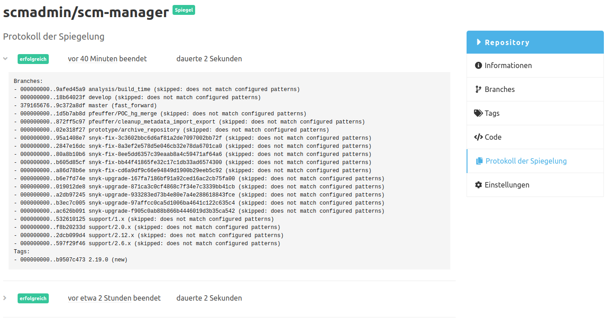

Im SCM-Manager gibt es neben dem Erstellen eines neuen Repositories 
und dem Importieren eines bestehenden Repositories noch einen dritten Modus: **Repository Spiegeln**.

Über das Formular können eine URL, mögliche Zugangsdaten und ein Synchronisierungsintervall definiert werden.
Zusätzlich werden die SCM-Manager üblichen Informationen zum neuen Repository abgefragt.

Optional gibt es verschiedene Filter (diese Filter haben keinen Einfluss auf das Spiegeln von SVN Repositories):

**Nur Fast-Forward**

Wenn dieses gewählt ist, werden Änderungen an Branches oder Tags nicht übernommen, wenn diese "forciert" wurden.

**Branches und Tags**

Jedes Glob-Muster, zum Beispiel `main`, `develop` oder `release/*`, wird mit der Eingabetaste hinzugefügt.
Bestätigte Muster erscheinen als Chips und können einzeln entfernt werden. Nur hinzugefügte Muster werden gespeichert;
noch nicht bestätigter Text wird nicht gespeichert. Branches und Tags werden nur übernommen, wenn sie einem der hinzugefügten Muster entsprechen.
Ist hier nichts eingetragen, wird nicht nach Namen gefiltert.

Werden diese Muster später geändert, werden Branches und Tags, die nicht mehr passen, bei der nächsten Synchronisation aus dem Mirror entfernt,
auch wenn sich das Quell-Repository nicht geändert hat.
Werden Aktualisierungen durch Fast-Forward- oder Signaturprüfungen abgelehnt, bleibt der bestehende Branch oder Tag erhalten.

**GPG Verifikation**

Es kann nach GPG signaturen gefiltert werden.
Für Branches werden die Signaturen des Commits geprüft, auf den der Branch zeigt.
Bei Tags wird deren eigene Signatur geprüft.

| Typ | Effect |
|:---:|---|
| Keine | No verification will take place |
| Beliebige Signatur | Es werden nur Branches und Tags mit einer gültigen Signatur gespiegelt. |
| Signatur eines SCM-Manager Users | Branches und Tags werden nur dann gespiegelt, wenn eine Signatur eines SCM Benutzers vorhanden ist. |
| Vorgegebene Liste | Branches und Tags werden nur dann gespiegelt, wenn sie eine Signatur für einen der angegebenen öffentlichen Schlüssel haben. |

Auf Grundlage dieser Daten wird ein neues Repository im SCM-Manager erstellt
und der Inhalt von der externen Quelle gespiegelt.

Gespiegelte Repository werden über den **Spiegel**-Tag kenntlich gemacht.
Ein grauer Tag weist auf die laufende erstmalige Synchronisation mit der externen Quelle hin.
Wurden die Daten erfolgreich synchronisiert, ist der Tag grün.
Ein roter Tag bedeutet, dass während der Synchronisation Fehler aufgetreten sind.
Wurden Branches oder Tags aufgrund eines konfigurierten Filters (mit Ausnahme der Muster für Namen) nicht
übernommen, ist der Tag gelb.

Die Mirror-Einstellungen wie Zugangsdaten, Synchronisationsintervall und Filter können auch nachträglich
über das entsprechende [Einstellungsmenü](../config) im Repository angepasst werden. Zu beachten ist, dass die
URL **nicht mehr** geändert werden kann.

Der Synchronisationsstatus eines Mirrors wird direkt in der Code-Ansicht des Repositorys als Banner angezeigt:

- **Während einer Synchronisation** erscheint ein Banner – „Datenübertragung“ beim ersten Spiegeln bzw. „Spiegelung wird aktualisiert“ bei Folge-Läufen – mit einem durchgehenden Fortschrittsbalken.
- **Ist die letzte Synchronisation fehlgeschlagen**, wird ein rotes Banner mit einem Verweis auf das Mirror-Protokoll angezeigt.
- **Solange noch keine Sources vorhanden sind** (z. B. vor dem ersten erfolgreichen Lauf oder bei einer leeren Quelle), erscheint der Hinweis „Keine Sources in diesem Branch gefunden.“.

Die Ergebnisse der Synchronisation können in dem "Mirror-Protokoll" in der Navigation für das
Repository eingesehen werden.

Das Protokoll unterscheidet abgelehnte Aktualisierungen (`update rejected`, vorhandene Referenzen bleiben erhalten),
ausgeschlossene neue Referenzen (`excluded`) und entfernte vorhandene Referenzen (`deleted`).
Ein Filtergrund folgt nach einem Doppelpunkt.

